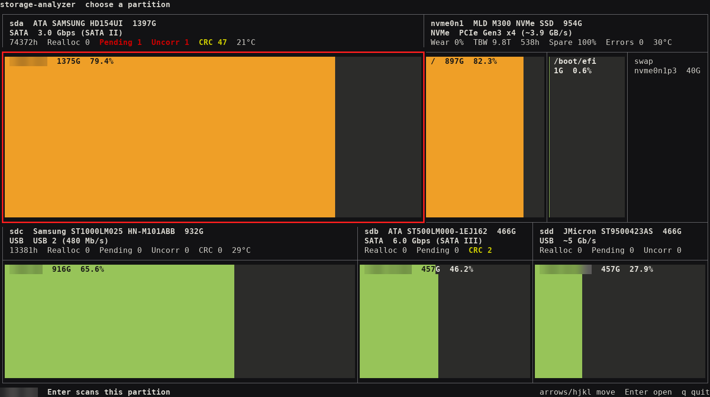
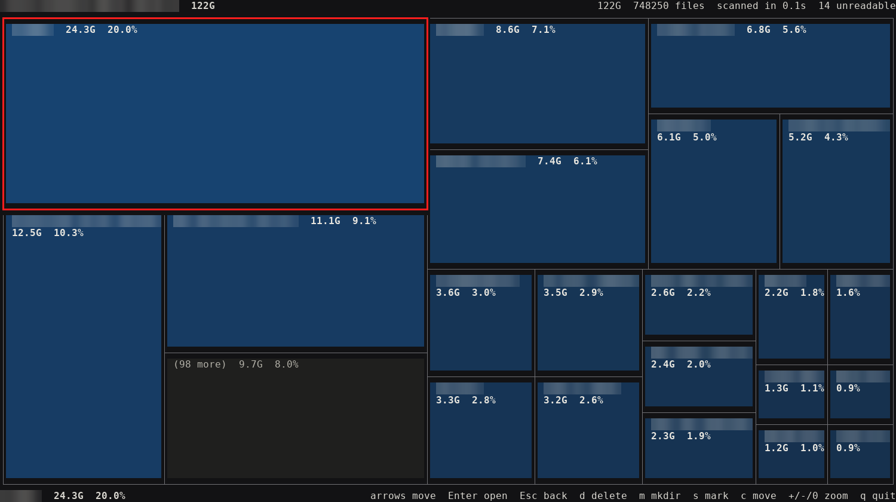
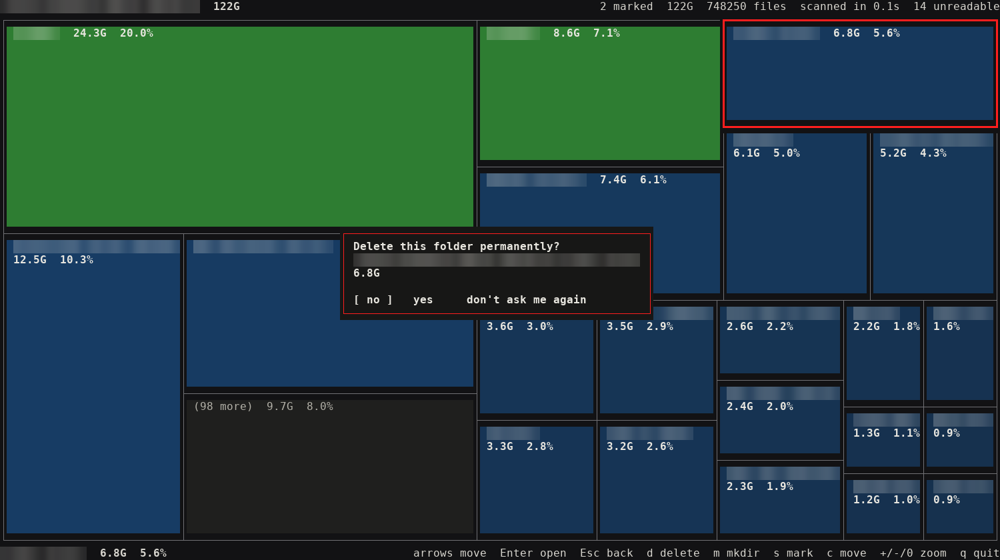

# storage-analyzer

`storage-analyzer` shows where your disk space went, as boxes you can walk through in the terminal.
It starts on a map of your physical disks and partitions, sized by capacity and filled with colour
by usage. Open a partition and its folders become boxes sized by what they occupy; open a folder to
go deeper, and delete or move what you find. It is a single static binary with no runtime
dependencies.

The screenshots are real runs; only the folder names are blurred.







## How it reads

- Disk map: every disk is a box sized by its capacity and shows its model, bus, maximum link speed
  and health. Partitions are boxes inside it, with a bar for the used space: green below 70%, amber
  below 90%, red above.
- Folder view: every box is a child of the folder on screen. Folders are blue and files grey, and a
  larger share of the folder gives a stronger colour. Folders are written with a trailing `/`.
- The selected box has a heavy bright red frame, and marked boxes are green.
- `+` hides the largest item of the folder so that the others get more room; `-` brings it back and
  `0` shows everything again.
- With `--ascii`, used space is `#` and free space is `.`. The Linux console uses this automatically.
- Boxes that would be too small to read are merged into one `(N more)` box.
- The map fills in while the scan runs; you can walk through it before the scan ends. For a
  partition opened from the disk map, the top right shows how much of its used space was found.
- A scan that finished is kept while the program runs, so going back and forth is instant. Opening
  another partition stops a scan that has not finished.

## Changing files

| Key | Action |
| --- | --- |
| `d`, `Delete` | Delete the selected file or folder |
| `m` | Create a folder here |
| `s` | Mark or unmark the selected item |
| `c` | Move the marked items into a folder of this folder |

Deleting is permanent, without a trash folder. The prompt starts on `no`. Choosing
`don't ask me again` lasts until the program ends.

The box leaves the map as soon as you confirm, and the deletion runs in the background on the
scanning thread count; the top right shows how many items are gone. If it fails, the box comes back
and part of the folder may be gone. Quitting while a deletion runs needs a second press, because
it abandons the deletion halfway.

Measured on a mirror of a real build tree (1.65 million files and 360 thousand folders, NVMe, ext4,
files already in the page cache):

| Method | Time |
| --- | --- |
| `rm -rf` | 14.5 s |
| One thread | 14.9 s |
| 8 threads | 4.2 s |
| 25 threads | 4.0 to 4.4 s |

- Disk changes wait until the scan has finished. Marks belong to the folder on screen and are
  dropped when you leave it.
- A folder with a filesystem mounted anywhere inside it cannot be deleted or moved. While deleting,
  the kernel also refuses to follow a symbolic link or to cross into another mount.
- Top-level system folders such as `/usr` cannot be deleted or moved.
- Moving never replaces anything: an item whose name already exists at the destination stays where
  it is and the failure is reported.
- Symbolic links are removed as links; what they point to is left alone.
- Items with names that are not valid UTF-8 cannot be changed from here.
- Small files merged inside a folder with more than 128 files have no box of their own, so they
  can only be changed from another tool.

## Disk health

Run the program with `sudo` to see a health row in every disk box; without root it says
`SMART: needs root`. The values are read directly from the drive through the kernel.

| Value | Meaning | Shown for |
| --- | --- | --- |
| `Wear` | Share of the rated life used, as reported by the drive | NVMe, known SATA SSDs |
| `TBW` | Total data written, in decimal terabytes | NVMe, known SATA SSDs |
| `h` | Power-on hours | All |
| `Spare` | Spare capacity left | NVMe |
| `Errors` | Media and data integrity errors | NVMe |
| `Realloc`, `Pending`, `Uncorr` | Bad sectors: remapped, waiting, unreadable | SATA |
| `CRC` | Transfer errors, usually a cable or a USB bridge | SATA |
| `°C` | Current temperature | All |

Red marks a value that indicates a failing disk and yellow one that deserves attention. When a box
is narrow, healthy values are dropped first. A SATA disk that reports being in standby is not woken
and shows `SMART: disk asleep`. Wear and TBW of SATA SSDs differ per vendor, so they are shown only
for Samsung, Crucial and Micron drives. RAID controllers and bridges that do not pass ATA commands
through show `SMART: n/a`.

## What is counted

- The space really occupied on disk (`st_blocks`), like `du`, not the apparent file size.
- Hard links count once. Which of the paths receives the size depends on which is seen first.
- A scan stays on one filesystem: other filesystems mounted below it are skipped.
- A folder that cannot be read counts as `unreadable` at the top right. Run as root to see them.
- Each folder keeps the 128 largest files by name. The others stay in the totals as one
  merged entry, which keeps memory low on very large trees.

## Scan speed

A scan uses 80% of the CPU cores on a solid state disk. On a rotating disk it uses one thread,
to avoid constant head movement; `--threads` overrides this.

Measured on one machine (32 threads, NVMe, ext4, files already in the page cache) against
gdu 5.36.1, on a tree of 21.3 million files and 4.8 million folders:

| Tool and mode | Time | Peak memory |
| --- | --- | --- |
| `storage-analyzer --summary` | 33.8 s | 1.7 GB |
| `gdu -npcsx` (total only, keeps no tree) | 28.9 s | 0.6 GB |
| `gdu -npcx -o /dev/null` (keeps the tree) | 61.2 s | 34 GB |

## Requirements

- Linux with sysfs and procfs. Nothing else is needed at run time.
- Root for the disk health row, and to scan folders your user cannot read.

## Installation

Download the static Linux x86_64 binary from the latest release:

```bash
curl -L -o storage-analyzer https://github.com/stulluk/storage-analyzer/releases/latest/download/storage-analyzer-x86_64-linux-musl
chmod +x storage-analyzer
```

Every push to `main` is tested and rebuilds the release of the version in `Cargo.toml`.

To build it yourself, see [Contributing](#contributing).

## Usage

```bash
storage-analyzer
storage-analyzer /some/folder
storage-analyzer --summary /some/folder --threads 8
sudo storage-analyzer --health
storage-analyzer --ascii
```

| Key | Action |
| --- | --- |
| Arrow keys, `h` `j` `k` `l` | Move between boxes |
| `Enter` | Open the selected partition or folder |
| `Backspace`, `Esc` | Go one level up |
| `+`, `-`, `0` | Zoom in, zoom out, reset |
| `d`, `m`, `s`, `c` | Delete, create folder, mark, move (see above) |
| `q`, `Ctrl-C` | Quit |

`--summary` and `--health` print their result without starting the interface.

## Contributing

The toolchain stays inside Docker. Build the image once, then format, test, lint and compile:

```bash
./dockerbuild.sh
./indockerbuild.sh 25 fmt
./indockerbuild.sh
```

The static binary is written to `out/storage-analyzer`.
